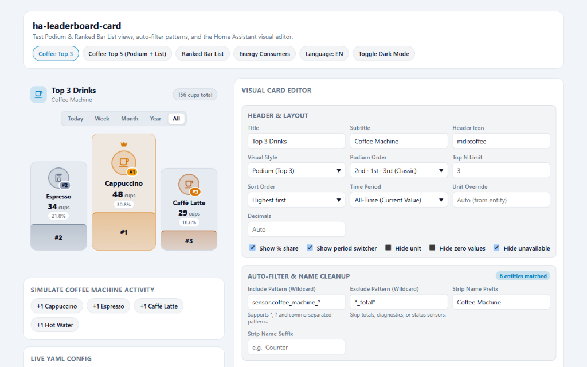

# Leaderboard Card for Home Assistant

[](https://github.com/hacs/integration)
[](https://github.com/nicolasjweber/ha-leaderboard-card/actions/workflows/validate.yml)
[](LICENSE)

A general-purpose, responsive Home Assistant Lovelace card that ranks numeric entities and displays the **Top N** in a stepped **3-Place Podium** or **Ranked Progress Bar List**, ideal for coffee machine drink counters, top energy consumers, room temperatures, or any numeric sensors.



## Features

- **Two Visual Layouts (or Both)**:
  - `podium`: Classic stepped 3-place podium (`2nd · 1st · 3rd` or `1st · 2nd · 3rd`) with gold/silver/bronze accents, crown badge, and optional runner-up list when `limit > 3`.
  - `list`: Ranked rows with relative progress bars, rank badges, and % of total share.
  - `both`: Top 3 Podium paired with a Ranked Bar List below.
- **Time Period Ranking & Inline Switcher**: Rank entities over `today`, `week`, `month`, `year`, `this_week`, `this_month`, or `this_year` directly from Home Assistant Long-Term Statistics (with automatic History fallback), with no Utility Meter helpers required. Optionally show a centered inline switcher (`Today · Week · Month · Year · All`).
- **Auto-Filter & Wildcards**: Automatically discover and rank entities using `include_pattern` / `exclude_pattern` (e.g., `sensor.coffee_machine_*` excluding `*_total*`), or advanced `filter.include` / `filter.exclude` rules (by `domain`, `area`, `device`, `state_min`, `state_max`, `attributes`).
- **Name Cleanup**: Strip repetitive prefixes/suffixes (`name_strip_prefix: "Coffee Machine "`) automatically while preserving per-entity custom overrides.
- **Bilingual UI (English & German)**: Automatically adapts to Home Assistant's language (`en` / `de`) or an explicit `language` override.
- **Visual GUI Editor**: Configure layout, time period, limits, sort order, filters, and per-entity icon/name/color overrides directly in the Home Assistant UI.
- **Native Home Assistant Integration**: Adapts to your active light/dark theme, supports Sections grid sizing, and opens the entity's More Info dialog on tap or keyboard activation.
- **Zero Dependencies**: Single self-contained `ha-leaderboard-card.js` ES module.

---

## Installation

### Option 1: HACS (Recommended)

1. Open **HACS** in Home Assistant → **Frontend** → menu (⋮) → **Custom repositories**.
2. Add this repository URL and select **Dashboard** (or **Lovelace**) as the category.
3. Search for **Leaderboard Card** and click **Download**.
4. Reload your browser cache.

### Option 2: Manual Installation

1. Download [`ha-leaderboard-card.js`](ha-leaderboard-card.js) from the latest release (or repository root).
2. Copy it to `/config/www/ha-leaderboard-card.js`.
3. In Home Assistant, go to **Settings → Dashboards → Resources → Add Resource**:
   - **URL**: `/local/ha-leaderboard-card.js`
   - **Resource type**: `JavaScript Module`

---

## Quick Examples

### Coffee Machine Top 3 Drinks (Auto-Filter)

Automatically ranks all coffee machine drink counters, strips `"Coffee Machine "` from the names, excludes the total/cleaning counters, and shows the top 3 on a podium:

```yaml
type: custom:ha-leaderboard-card
title: Top 3 Drinks
subtitle: Coffee Machine
header_icon: mdi:coffee
layout: podium
limit: 3
include_pattern: sensor.coffee_machine_*
exclude_pattern: "*_total*, *_cleaning*, *_state*"
name_strip_prefix: "Coffee Machine "
show_percentage: true
entities:
  - entity: sensor.coffee_machine_cappuccino
    icon: mdi:coffee
  - entity: sensor.coffee_machine_espresso
    icon: mdi:coffee-maker
  - entity: sensor.coffee_machine_hot_water
    icon: mdi:water
```

### Weekly / Monthly / Yearly Leaderboard (with Period Switcher)

Rank entities over a time window without creating extra Home Assistant Utility Meter helpers, and optionally let dashboard users switch periods inline:

```yaml
type: custom:ha-leaderboard-card
title: Drink Trends
header_icon: mdi:trophy
layout: podium
limit: 3
period: week
show_period_selector: true
include_pattern: sensor.coffee_machine_*
exclude_pattern: "*_total*, *_cleaning*, *_state*"
name_strip_prefix: "Coffee Machine "
```

### Manual Entity List (Any Entities)

```yaml
type: custom:ha-leaderboard-card
title: Top Energy Consumers
subtitle: Today
header_icon: mdi:flash
layout: both
limit: 5
decimals: 1
entities:
  - entity: sensor.ev_charger_energy
    name: EV Charger
    color: "#38bdf8"
  - entity: sensor.heat_pump_energy
    name: Heat Pump
    color: "#f59e0b"
  - entity: sensor.kitchen_energy
    name: Kitchen
  - entity: sensor.office_energy
    name: Office
  - entity: sensor.laundry_energy
    name: Laundry
```

---

## Configuration Options

| Option | Type | Default | Description |
| :--- | :--- | :--- | :--- |
| `title` | `string` | `""` | Card header title (hidden when empty). |
| `subtitle` | `string` | `""` | Optional subtitle below the title. |
| `header_icon` | `string` | `""` | Optional MDI icon in the header (e.g. `mdi:coffee`). |
| `language` | `'en' \| 'de'` | auto | UI language (`en` or `de`); defaults to Home Assistant's configured language. |
| `layout` | `'podium' \| 'list' \| 'both'` | `'podium'` | Visual layout mode. |
| `podium_order` | `'2-1-3' \| '1-2-3'` | `'2-1-3'` | Column order for the 3-place podium. |
| `limit` | `number` | `3` | Maximum number of ranked entities to show (`1..50`). |
| `sort_order` | `'desc' \| 'asc'` | `'desc'` | Rank highest values first (`desc`) or lowest first (`asc`). |
| `period` | `'all' \| 'today' \| 'week' \| 'month' \| 'year' \| 'this_week' \| 'this_month' \| 'this_year'` | `'all'` | Rank values over a time window via Home Assistant Long-Term Statistics (with history fallback). |
| `show_period_selector` | `boolean` | `false` | Show an inline period switcher (`Today · Week · Month · Year · All`) on the card. |
| `unit` | `string` | `""` | Global unit override; falls back to each entity's `unit_of_measurement`. |
| `hide_unit` | `boolean` | `false` | Hide unit labels on items and in the header total badge. |
| `decimals` | `number` | `null` | Decimal places (`null` = auto: whole numbers omit decimals, others show 1). |
| `show_percentage` | `boolean` | `true` | Show percentage share of the matched total. |
| `hide_zero` | `boolean` | `false` | Hide entities whose numeric value is `<= 0`. |
| `hide_unavailable` | `boolean` | `true` | Hide entities in `unavailable`, `unknown`, or non-numeric states. |
| `include_pattern` | `string` | `""` | Comma-separated wildcard pattern(s) matching `entity_id` (supports `*` and `?`). |
| `exclude_pattern` | `string` | `""` | Comma-separated wildcard pattern(s) to exclude from results. |
| `name_strip_prefix` | `string` | `""` | Prefix stripped from entity friendly names when no custom `name` is set. |
| `name_strip_suffix` | `string` | `""` | Suffix stripped from entity friendly names when no custom `name` is set. |
| `entities` | `array` | `[]` | List of entity IDs, wildcard strings, or objects `{ entity, name, icon, color, unit, attribute }`. |
| `filter` | `object` | `null` | Advanced `{ include: [...], exclude: [...] }` rules matching `entity_id`, `domain`, `name`, `area`, `device`, `state_min`, `state_max`, `attributes`. |

---

## Local Development & Testing

```sh
# Build ha-leaderboard-card.js and dist/ha-leaderboard-card.js
node scripts/build.mjs

# Run unit tests
node --test test/leaderboard.test.mjs
```

You can open `index.html` via any local static file server (e.g. `node scripts/serve.mjs`) to preview the card and visual editor interactively.
